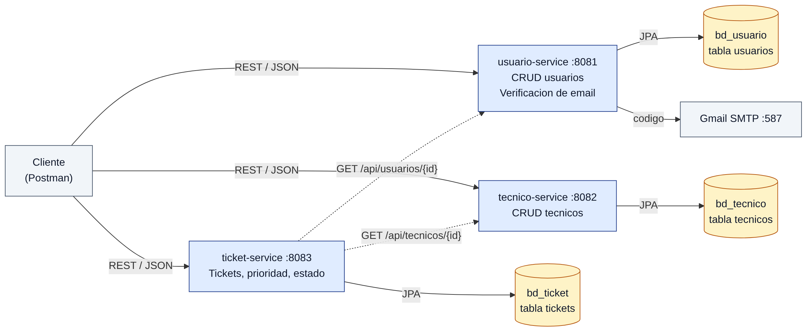

# Sistema de Soporte Técnico — Microservicios (Laboratorio 16)

**Curso:** Desarrollo de Aplicaciones Web — Evaluación 03 (Microservicios)
**Estudiante:** Millones Vasquez, Daniel Alejandro

Sistema que registra **usuarios**, **técnicos** y **tickets** de soporte, separado en tres microservicios
Spring Boot independientes. Cada uno tiene su propio puerto y su propia base de datos.

---

## 1. Arquitectura



| Microservicio   | Puerto | Base de datos | Responsabilidad |
|-----------------|--------|---------------|-----------------|
| usuario-service | 8081   | bd_usuario    | CRUD de usuarios + verificación de email por código (SMTP Gmail) |
| tecnico-service | 8082   | bd_tecnico    | CRUD de técnicos |
| ticket-service  | 8083   | bd_ticket     | Tickets: prioridad, estado y validación de usuario/técnico vía HTTP |

- Cada servicio **solo accede a su propia BD**. No se comparten tablas.
- `ticket-service` guarda únicamente `idUsuario` e `idTecnico`, y valida que existan consultando a los otros servicios con **RestTemplate**.

## 2. Tecnologías
Java 17+ · Spring Boot 3.3.5 · Spring Web · Spring Data JPA · Validation · Spring Mail ·
MariaDB Driver (`mariadb-java-client`) · Lombok · MapStruct · DevTools · Docker / Docker Compose · Postman

## 3. Estructura del proyecto
```
microservicios-soporte-tecnico/
├─ database/script.sql            Script de las 3 BD con datos de prueba
├─ docs/img/                      Diagrama de microservicios
├─ postman/                       Colección y environment de Postman
├─ usuario-service/  ─┐
├─ tecnico-service/   ├─ Dockerfile, .dockerignore, .env, pom.xml, src/
├─ ticket-service/   ─┘
├─ docker-compose.yml
├─ .env                           Variables de Docker Compose
└─ pom.xml                        POM agregador (abre los 3 módulos en IntelliJ)
```

Paquetes de cada servicio:
```
model/       Entidades JPA (+ enums Prioridad y Estado en ticket)
dto/         RequestDTO (entrada con validaciones) y ResponseDTO (salida)
mapper/      Interfaces MapStruct (DTO <-> Entidad)
repository/  Interfaces JpaRepository
services/    Interfaz + implementación (reglas de negocio)
controller/  Endpoints REST
exception/   Excepciones propias + GlobalExceptionHandler + ErrorResponse
client/      (ticket) UsuarioClient y TecnicoClient con RestTemplate
config/      (ticket) RestTemplateConfig
```

## 4. Requisitos
- JDK 17 o superior (probado con JDK 24) · Maven 3.9+ o el Maven de IntelliJ
- MariaDB (XAMPP) en `localhost:3306`
- Docker Desktop (opcional, para ejecutar con contenedores)
- Postman

## 5. Ejecución local (IntelliJ + XAMPP)
1. Iniciar **MySQL (MariaDB)** en el panel de XAMPP.
2. Ejecutar `database/script.sql` completo en SQLyog o phpMyAdmin (con auto-commit).
3. Completar los `.env` de cada servicio (ver sección 7).
4. Abrir la carpeta `microservicios-soporte-tecnico` en IntelliJ.
5. Ejecutar en este orden:
   1. `UsuarioServiceApplication` (8081)
   2. `TecnicoServiceApplication` (8082)
   3. `TicketServiceApplication` (8083)

En consola debe aparecer `The following 1 profile is active: "dev"`.

## 6. Ejecución con Docker
Primero hay que **detener los servicios de IntelliJ**, porque usan los mismos puertos.
```bash
docker compose up --build -d     # construye las 3 imágenes y levanta todo
docker compose ps                # estado de los contenedores
docker compose logs -f ticket-service
docker compose down              # apagar (con -v también borra la BD del contenedor)
```

| Contenedor | Imagen | Puerto en el host |
|---|---|---|
| soporte-mariadb | mariadb:11.4 | 3307 (no choca con XAMPP) |
| usuario-service | soporte/usuario-service:1.0 | 8081 |
| tecnico-service | soporte/tecnico-service:1.0 | 8082 |
| ticket-service | soporte/ticket-service:1.0 | 8083 |

- Cada `Dockerfile` es **multi-stage**: Maven compila el `.jar` y la imagen final solo lleva JRE 21 + `.jar`.
- `database/script.sql` se ejecuta automáticamente la primera vez que se crea el contenedor de MariaDB.
- Dentro de la red Docker, ticket-service llama a `http://usuario-service:8081` y `http://tecnico-service:8082`.
- La BD de Docker es **independiente** de XAMPP. Para verla desde SQLyog: `127.0.0.1:3307`, usuario `root`, clave `root123`.

## 7. Variables de entorno
Cada servicio tiene un `.env` al lado de su `pom.xml`. El YAML lo carga con
`spring.config.import: optional:file:.env[.properties]`. Los `.env` están en `.gitignore`, así que **no se suben a GitHub**.

| Variable | Servicio | Valor por defecto | Para qué |
|---|---|---|---|
| `SPRING_PROFILES_ACTIVE` | los 3 | `dev` | Perfil activo (`dev` / `prod`) |
| `DB_URL` | los 3 | `jdbc:mariadb://localhost:3306/bd_xxx` | URL de la BD |
| `DB_USERNAME` / `DB_PASSWORD` | los 3 | `root` / vacío | Credenciales de MariaDB |
| `MAIL_USERNAME` / `MAIL_PASSWORD` | usuario | vacío | Cuenta Gmail + contraseña de aplicación |
| `MAIL_ENABLED` | usuario | `true` | `false` = el código se muestra en consola |
| `USUARIO_SERVICE_URL` / `TECNICO_SERVICE_URL` | ticket | `http://localhost:8081` / `8082` | Ubicación de los otros servicios |
| `DB_ROOT_PASSWORD` | `.env` raíz (Docker) | `root123` | Clave root del contenedor MariaDB |

## 8. Perfiles dev / prod
**dev** es el perfil por defecto, tanto en local como en Docker. Para usar **prod**, hay que definir `SPRING_PROFILES_ACTIVE=prod`:
en IntelliJ desde *Run → Edit Configurations → Environment variables*, o en Docker desde el `.env` de la raíz.

| Propiedad | dev | prod |
|---|---|---|
| URL de BD | `localhost` + `createDatabaseIfNotExist=true` | `${DB_URL}` |
| Usuario / clave BD | `root` / vacío | `${DB_USERNAME}` / `${DB_PASSWORD}` |
| `ddl-auto` | `update` (crea/actualiza tablas) | `validate` (solo verifica) |
| `show-sql` | `true` | `false` |
| Nivel de log | `DEBUG` | `INFO` |
| URLs de otros servicios (ticket) | `localhost:8081/8082` | `usuario-service:8081` / `tecnico-service:8082` |

## 9. Endpoints
### usuario-service — `http://localhost:8081/api/usuarios`
| Método | Ruta | Descripción |
|---|---|---|
| GET | `/` | Listar |
| GET | `/{id}` | Buscar por ID |
| POST | `/` | Registrar (queda `verificado=false` y se envía un código al correo) |
| PUT | `/{id}` | Actualizar (si cambia el email, se envía un nuevo código) |
| DELETE | `/{id}` | Eliminar |
| POST | `/{id}/verificar` | Verificar email `{ "codigo": "123456" }` |
| POST | `/{id}/reenviar-codigo` | Reenviar código |

### tecnico-service — `http://localhost:8082/api/tecnicos`
| Método | Ruta | Descripción |
|---|---|---|
| GET | `/` | Listar |
| GET | `/{id}` | Buscar por ID |
| POST | `/` | Registrar |
| PUT | `/{id}` | Actualizar |
| DELETE | `/{id}` | Eliminar |

### ticket-service — `http://localhost:8083/api/tickets`
| Método | Ruta | Descripción |
|---|---|---|
| GET | `/` | Listar |
| GET | `/{id}` | Buscar por ID |
| GET | `/{id}/detalle` | Ticket + datos del usuario y del técnico |
| GET | `/usuario/{idUsuario}` | Tickets de un usuario |
| GET | `/tecnico/{idTecnico}` | Tickets de un técnico |
| POST | `/` | Registrar (estado inicial `ABIERTO`) |
| PUT | `/{id}` | Editar datos (no el estado) |
| PATCH | `/{id}/estado` | Cambiar estado `{ "estado": "EN_PROCESO" }` |
| DELETE | `/{id}` | Eliminar |

## 10. Reglas de negocio
- **Prioridad:** `BAJA`, `MEDIA`, `ALTA`. **Estado:** `ABIERTO`, `EN_PROCESO`, `CERRADO`.
- **Transiciones permitidas:** `ABIERTO → EN_PROCESO | CERRADO` y `EN_PROCESO → CERRADO`. `CERRADO` es un estado final.
- Al crear o editar un ticket se verifica, por HTTP, que el usuario y el técnico existan.
- Solo los usuarios con **email verificado** pueden crear tickets.
- El email es único en usuarios y en técnicos.
- Un ticket `CERRADO` no se puede editar.

## 11. Manejo de errores (formato único en los 3 servicios)
```json
{
  "timestamp": "2026-11-06 16:00:00",
  "status": 400,
  "error": "Bad Request",
  "message": "Datos de entrada invalidos",
  "path": "/api/tickets",
  "errors": { "asunto": "El asunto es obligatorio" }
}
```
| Caso | HTTP |
|---|---|
| ID inexistente / ruta inexistente | 404 |
| Validación fallida, JSON mal formado, enum inválido, ID no numérico, código incorrecto o vencido | 400 |
| Email duplicado, usuario no verificado, transición de estado inválida, ticket cerrado | 409 |
| Otro microservicio apagado / fallo SMTP | 503 |
| Error no controlado | 500 |

## 12. Datos de prueba (`database/script.sql`)
| BD | Datos |
|---|---|
| bd_usuario | Usuarios 1–3 verificados · Usuario 4 (Jorge) **no verificado**, código `123456` |
| bd_tecnico | Técnicos 1–3 (Redes, Hardware, Software) |
| bd_ticket | Tickets 1–3 abiertos o en proceso · Ticket 4 **CERRADO** |

---

## 13. Pruebas con Postman
Archivos en `postman/`:
- `SoporteTecnico.postman_collection.json`: 40 peticiones con tests automáticos.
- `SoporteTecnico.postman_environment.json`: environment *Soporte Tecnico - Local / Docker*.

| Variable | Valor |
|---|---|
| `baseUsuario` | `http://localhost:8081` |
| `baseTecnico` | `http://localhost:8082` |
| `baseTicket` | `http://localhost:8083` |
| `emailVerificacion` | `daniel.millones@tecsup.edu.pe` |
| `codigoVerificacion` | *(se completa con el código recibido)* |
| `idUsuarioNuevo` / `idTecnicoNuevo` / `idTicketNuevo` | *(se llenan solos con los tests)* |

**Cómo usarlas:**
1. En Postman: *Import* → seleccionar los dos archivos.
2. Arriba a la derecha, elegir el environment **Soporte Tecnico - Local / Docker**.
3. Ejecutar las carpetas en orden: **1 → 2 → 3 → 4 → 5**.
4. Después de *Registrar usuario*, revisar el correo **daniel.millones@tecsup.edu.pe**, copiar el código de 6 dígitos en la variable `codigoVerificacion` y ejecutar *Verificar email*.

### 13.1 Casos de prueba
| # | Prueba | Petición | Esperado |
|---|---|---|---|
| 1 | Listar usuarios | `GET /api/usuarios` | 200 |
| 2 | Registrar usuario | `POST /api/usuarios` | 201, `verificado: false` |
| 3 | Correo con el código | Bandeja de daniel.millones@tecsup.edu.pe | Código de 6 dígitos |
| 4 | Verificar email | `POST /api/usuarios/{id}/verificar` | 200, `verificado: true` |
| 5 | Registrar técnico | `POST /api/tecnicos` | 201 |
| 6 | Registrar ticket | `POST /api/tickets` | 201, `estado: ABIERTO` |
| 7 | Cambiar a EN_PROCESO | `PATCH /api/tickets/{id}/estado` | 200 |
| 8 | Cambiar a CERRADO | `PATCH /api/tickets/{id}/estado` | 200, `fechaCierre` |
| 9 | Detalle del ticket | `GET /api/tickets/1/detalle` | 200, ticket + usuario + técnico |
| 10 | ID inexistente | `GET /api/tickets/999` | 404 |
| 11 | Campos vacíos | `POST /api/usuarios` | 400 + `errors` por campo |
| 12 | Prioridad inválida | `POST /api/tickets` con `"URGENTE"` | 400 |
| 13 | Email duplicado | `POST /api/usuarios` con `ana.torres@empresa.com` | 409 |
| 14 | Usuario inexistente en ticket | `POST /api/tickets` con `idUsuario: 999` | 404 |
| 15 | Usuario no verificado | `POST /api/tickets` con `idUsuario: 4` | 409 |
| 16 | Ticket cerrado | `PATCH /api/tickets/4/estado` | 409 |
| 17 | Servicio apagado | Apagar usuario-service → `POST /api/tickets` | 503 |

---

## 14. Documentación y evidencias
Las capturas de todas las pruebas (Postman, base de datos, IntelliJ y Docker) están en Google Drive:

📁 **[Evidencias - Laboratorio 16 Soporte Técnico](https://drive.google.com/drive/folders/1VTiFfvp2iTF8kDAqEp7zuapE2WLADUO5)**

| Carpeta en Drive | Contenido |
|---|---|
| `01-base-de-datos` | Las 3 BD separadas en SQLyog (XAMPP y Docker) |
| `02-ejecucion` | Servicios en IntelliJ (perfil dev), `docker compose ps`, Docker Desktop |
| `03-casos-exitosos` | Pruebas 1–9 de Postman + correo con el código de verificación |
| `04-casos-error` | Pruebas 10–17 de Postman (400, 404, 409, 503) |
| `05-postman-runner` | Ejecución completa de la colección con los tests aprobados |

Documentación incluida en este repositorio:
- `docs/img/00-diagrama-microservicios.png`: diagrama de microservicios y bases de datos.
- `database/script.sql`: script de las 3 bases de datos con datos de prueba.
- `postman/`: colección y environment de Postman.

## 15. Conclusiones
1. Separar el sistema en tres microservicios, cada uno con su propia BD, permite modificar, desplegar o escalar uno sin afectar a los demás.
2. Los DTO junto con MapStruct separan el contrato JSON de la entidad JPA, y evitan exponer campos internos como el código de verificación.
3. Un `GlobalExceptionHandler` con un `ErrorResponse` común hace que todos los servicios respondan errores claros y consistentes (400, 404, 409, 503).
4. Los perfiles dev/prod y las variables de entorno permiten ejecutar el mismo código en local o en Docker sin modificar el YAML.
5. La comunicación entre servicios con RestTemplate mantiene la integridad de los datos sin claves foráneas entre bases de datos distintas.

**Dificultad encontrada:** el proyecto no compilaba en JDK 24 (`ExceptionInInitializerError ... TypeTag :: UNKNOWN`), porque Spring Boot 3.3.5 trae una versión de Lombok sin soporte para ese JDK.
**Solución:** se fijó `lombok.version` en 1.18.42 dentro de los `pom.xml`.
